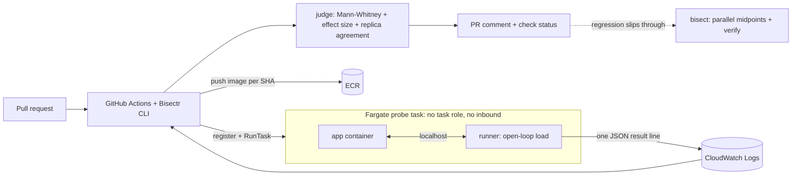

# Bisectr

A cost-and-performance gate for container services, with automatic bisect as the safety net.

Bisectr runs your pull request and your main branch side by side on AWS Fargate under identical load,
compares them statistically, and reports on the PR whether the change made the service slower, flakier
or more expensive to run. If a regression slips through, Bisectr binary-searches the commit range and
names the responsible commit.

> **Status:** hackathon build. Every number in the results table must come from `eval/results.csv`,
> produced by `bisectr eval` on real Fargate runs. Cells marked `TODO(measure)` have not been measured yet.

## How it works



* **Gate:** baseline (main) and candidate (PR) probes launch at the same moment, 3 replicas each.
  A candidate is *bad* only if the latency difference is statistically significant (Mann-Whitney),
  material (p95 ratio >= 1.25) and reproduced by at least 2 of 3 replicas. Inconclusive results are
  re-probed once with a longer run.
* **Cost:** measured CPU-seconds per request is converted to tasks needed at a target RPS (a sizing
  estimate, not a billing report).
* **Bisect:** k midpoints per round in parallel, `skip` for commits without an image, and a verify
  step that re-measures the culprit and its parent with 2x samples. It reports an ambiguous window
  rather than a confident wrong commit.
* **Security:** PR code is untrusted. Probe tasks have no task role and no inbound access; results
  travel through the runner's own log stream. CI uses GitHub OIDC, never static keys.

## Quick start

```bash
python3.12 -m venv .venv && source .venv/bin/activate && pip install -e ".[dev]"
cd infra/envs/dev && terraform init && terraform apply && cd ../../..
git add -A && git commit -m init && ./scripts/push_images.sh
python scripts/gen_config.py            # then set pricing in bisectr.yaml
make gate-ok                            # control: expect PASS
make gate-bad                           # injected regression: expect FAIL
make history                            # real 10-commit history with one slow commit
```

Bisect demo:

```bash
cd ../bisectr-demo-history
bisectr bisect --config ../bisectr/bisectr.yaml --good <first_sha> --bad <last_sha>
```

## Commands

| Command | Purpose |
|---|---|
| `bisectr gate --candidate SHA [--baseline SHA\|auto]` | A/B probe, verdict, PR comment with `--post --pr N` |
| `bisectr bisect --good SHA --bad SHA` | Find the first bad commit; opens an issue with `--post` |
| `bisectr eval --image SHA` | Evaluation harness, writes `eval/results.csv` |

## Evaluation

`eval/scenarios.yaml` injects regressions (`n_plus_one`, `slow_dependency`, `cpu_hot_loop`,
`error_rate`, `payload_bloat`) plus a noise-only control. Gate trials use one image with and without the
regression env var. Bisect trials use a synthetic history of 12 commits (the regression is injected from
a random commit onward). The real 10-commit history in `scripts/make_demo_history.sh` is used for the demo.

```bash
make eval        # prints the markdown table below
```

| Metric | Result |
|---|---|
| Gate: regressions detected (excluding control) | TODO(measure) |
| Gate: false positives on noise-only control | TODO(measure) |
| Gate: cost regressions detected (cpu_hot_loop, payload_bloat) | TODO(measure) |
| Bisect: exact culprit found | TODO(measure) |
| Bisect: wrong culprit reported | TODO(measure) |
| Bisect: ambiguous or flaky reported | TODO(measure) |
| Median wall time per gate run (s) | TODO(measure) |
| Median tasks per bisect | TODO(measure) |
| Median est. AWS cost per gate run (USD) | TODO(measure) |

The metrics that matter most are the wrong-culprit and false-positive rates. An "ambiguous" answer is
safe. A confident wrong commit or a spurious failing check destroys trust.

## Guardrails

Kill switch (`aws ssm put-parameter --name /bisectr/enabled --value false --overwrite`), per-PR
concurrency group, `max_probes`, task timeouts, EventBridge + Lambda reaper (stops tasks older than 30
minutes, deregisters old task definition revisions), AWS Budgets alert, same-repository PRs only.

## Limitations

* Assumes the regression is reproducible under a synthetic scenario.
* Bisect assumes a roughly monotonic regression; reverted or intermittent ones report flaky or ambiguous.
* The runner shares CPU with the app, so absolute numbers are not production latency. Results are valid
  as relative comparisons under identical reservations.
* Cost output is a sizing model, not a billing report.
* Baseline results are cached on local disk (`.bisectr_cache/`) in this build.
* Scope: HTTP services in containers on Fargate, GitHub as the source host.

## Repository layout

`src/bisectr` (CLI and engine), `runner/` (sidecar image), `demo-app/` (service with injectable
regressions), `infra/envs/dev` (Terraform), `lambdas/reaper`, `action/` (GitHub Action), `eval/`,
`tests/`, `scripts/`, `docs/`.

## License

MIT
