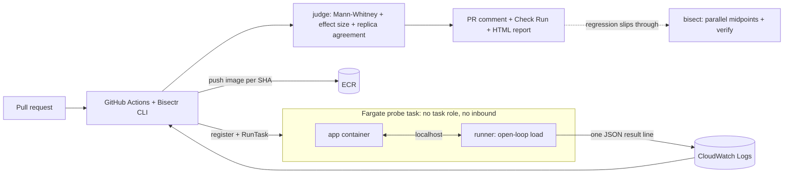

# Bisectr

Bisectr is a performance and cost regression gate for containerized HTTP services. It compares
baseline and candidate images under the same workload on AWS Fargate, reports a statistically
supported verdict, and can bisect a commit range when a regression is found.

[Read the complete project guide](docs/project-guide.pdf) for the architecture, workflows, features,
use cases, validation evidence, and operational limits.

> **Project status:** prototype / hackathon build. AWS-backed features require your own AWS account
> and infrastructure setup. The optional alarm automation is disabled by default and is not a
> production deployment rollback system. Evaluation results are specific to their workload,
> configuration, and sample size; see the measurement notes below.

## How it works



* **Gate:** baseline (main) and candidate (PR) probes launch at the same moment, 3 replicas each.
  A candidate is *bad* only if the latency difference is statistically significant (Mann-Whitney),
  material (p95 ratio >= 1.25) and reproduced by at least 2 of 3 replicas. Inconclusive results are
  re-probed once with a longer run.
* **Cost:** measured CPU-seconds per request is converted to tasks needed at a target RPS (a sizing
  estimate, not a billing report). Pricing is reported only when both vCPU and memory rates are set.
* **Bisect:** k midpoints per round in parallel, `skip` for commits without an image, and a verify
  step that re-measures the suspected culprit and its parent with 2x samples. It reports an
  ambiguous window rather than claiming an unverified culprit. A matching CloudWatch alarm can
  optionally start an investigation across the two latest successful main image builds; after a
  culprit is verified, automation opens a performance-checked revert PR for human review and never
  merges it.
* **Security:** PR code is untrusted. Probe tasks have no task role and no inbound access; results
  travel through the runner's own log stream. CI uses GitHub OIDC, never static keys.
* **Persistence and reports:** configured runs use DynamoDB for TTL-bound baseline cache and run
  records, with private HTML reports in S3. Reports include baseline/candidate latency percentiles;
  local configurations write reports and history under `runs/`.
* **Workload profiles:** name the scenario and mix weighted HTTP methods, paths, and JSON request
  bodies. GET-only endpoint configurations remain compatible. The runner sends requests at the
  configured open-loop rate.
* **Per-endpoint budgets:** endpoints may set `max_p95_ratio` and `max_error_delta`; reports show
  route-level p95, error rates, and budget verdicts rather than hiding a slow route in aggregate data.
* **Fix verification:** `bisectr verify-fix` compares a proposed fix image with a known-good image and
  reports a resolution only on PASS.

## Quick start

Install Bisectr and run its local tests:

```bash
python3.12 -m venv .venv && source .venv/bin/activate && pip install -e ".[dev]"
pytest -q
bisectr --help
```

To run Fargate probes, first configure AWS credentials, create the Terraform state bucket, and
configure the required Terraform variables for your AWS account and GitHub/GitLab setup. Then
provision the development infrastructure in `us-east-1`. The Terraform state bucket can remain in
its existing region; the S3 backend region below is the bucket's region, not the AWS provider region.
Use a new state key for the new regional stack so the active `ap-south-1` stack is preserved:

```bash
cd infra/envs/dev
terraform init -reconfigure \
  -backend-config="bucket=YOUR_TERRAFORM_STATE_BUCKET" \
  -backend-config="key=bisectr/dev/us-east-1/terraform.tfstate" \
  -backend-config="region=ap-south-1" \
  -backend-config="encrypt=true" \
  -backend-config="use_lockfile=true"
terraform apply \
  -var="region=us-east-1" \
  -var="github_repo=YOUR_OWNER/YOUR_REPO" \
  -var="gitlab_project_path=YOUR_GROUP/YOUR_PROJECT" \
  -var="gitlab_ref=main"
cd ../../..
./scripts/push_images.sh
python scripts/gen_config.py            # review bisectr.yaml and set pricing/workloads
make gate-ok                            # control: expect PASS
make gate-bad                           # injected regression: expect FAIL
```

`scripts/gen_config.py` reads Terraform outputs into `bisectr.yaml`. Back up custom settings before
regenerating the file; it must be regenerated after the `us-east-1` stack is applied because subnet,
security-group, ECR, and storage resources are region-specific. The existing `ap-south-1` stack and
its state are intentionally left in place until the new stack is verified. Configure
`pricing.vcpu_hour` and `pricing.gb_hour` from the AWS Fargate price list for `us-east-1` if you want
cost estimates. See [docs/validation.md](docs/validation.md) before running AWS-backed evaluation or
service validation.

### Try commit bisect

Create a disposable demo history with a known injected regression:

```bash
./scripts/make_demo_history.sh 10 6
cd ../bisectr-demo-history

GOOD=$(awk 'NR==1 {print $2}' ../bisectr-shas.txt)
BAD=$(tail -n 1 ../bisectr-shas.txt | awk '{print $2}')
bisectr bisect --config ../bisectr/bisectr.yaml --good "$GOOD" --bad "$BAD"
```

The history script creates sibling paths and refuses to overwrite existing output. Bisecting requires
the relevant commit images to be present in the configured ECR repository.

## Commands

| Command | Purpose |
|---|---|
| `bisectr gate --candidate SHA [--baseline SHA\|auto]` | A/B probe, verdict, PR comment and Check Run with `--post --pr N`; writes an HTML report |
| `bisectr suite --candidate SHA [--baseline SHA\|auto]` | Run one gate per configured `scenarios` profile; any failing profile fails the suite |
| `bisectr bisect --good SHA --bad SHA` | Find the first bad commit; opens an issue with `--post`; writes an HTML report |
| `bisectr verify-fix --baseline GOOD --candidate FIX` | Re-measure a proposed fix against a known-good version; reports resolved only on PASS |
| `bisectr eval --image SHA` | Evaluation harness, writes `eval/results.csv` |
| `python eval/noise_sensitivity.py` | Offline simulation of exact/wrong/undecided bisect rates as verdict flips increase |
| `bisectr validate --baseline IMAGE --candidate IMAGE [--trials N]` | Repeat a real image-to-image comparison without baseline caching; writes a CSV and stores each trial |
| `bisectr trends [--kind all\|gate\|bisect\|validate\|verify-fix]` | Summarize recent local or DynamoDB run history |
| `bisectr dashboard [--out runs/dashboard.html]` | Generate a local HTML run history dashboard |

For the full judge demo sequence—including the A/A control, injected regression, culprit search,
post-fix verification, and merge-blocking setup—see [docs/demo.md](docs/demo.md).

Cloud setup provisions DynamoDB tables for baseline caching and run records, a private S3 bucket for
HTML reports, a monthly AWS Budget with SNS alerts, and the probe resources. `scripts/gen_config.py`
reads these Terraform outputs into `bisectr.yaml`. Set `alert_email` and `monthly_budget_usd` in
Terraform variables to subscribe to budget alerts. Runs are blocked at 90% of the configured budget.
For local development, leave the three cloud storage fields unset; baseline data, run records, and
HTML reports are written under `.bisectr_cache/` and `runs/`.
Set `pricing.vcpu_hour` and `pricing.gb_hour` from the AWS Fargate price list for the configured
region before collecting cost estimates. `scripts/gen_config.py` preserves existing rates.

The Terraform state bucket is separate from the report bucket and must be created before `terraform
init`. Enable bucket versioning, encryption, and S3 Block Public Access. The backend uses S3 native
locking; see the migration notes in the [runbook](docs/runbook.md). Terraform
also adds a DynamoDB index used by `bisectr trends`; apply the state changes before using cloud trends.
The application resources default to `us-east-1`. Terraform's S3 backend `region` setting still needs
to match wherever your separately managed state bucket lives.

## Evaluation

`eval/scenarios.yaml` injects regressions (`n_plus_one`, `slow_dependency`, `cpu_hot_loop`,
`error_rate`, `payload_bloat`) plus a noise-only control. Gate trials use one image with and without the
regression env var. Bisect trials use a synthetic history of 12 commits (the regression is injected from
a random commit onward). The real 10-commit history in `scripts/make_demo_history.sh` is used for the demo.

```bash
make eval        # prints the markdown table below
```

For a 20-trial capture that does not append to existing results, specify a new output file:

```bash
.venv/bin/bisectr eval --image "$(git rev-parse HEAD)" --trials 20 \
  --out eval/results-20-trials.csv
.venv/bin/python scripts/fill_readme.py eval/results-20-trials.csv
```

If an authorized evaluation is interrupted, restart it with the same image, config, scenario file,
trial counts, and seed, adding `--resume` to skip rows already recorded in that CSV.

The evaluator defaults to three bisect trials per regression scenario; set `--bisect-trials` separately
if you need more statistical power for wrong-culprit rates. The offline noise sensitivity simulation
does not launch AWS tasks:

```bash
.venv/bin/python eval/noise_sensitivity.py --trials 1000
```

Synthetic bisect-noise simulation (1,000 trials per flip rate; not AWS measurements):

| Verdict flip rate | Exact culprit | Wrong culprit | Safely undecided |
|---:|---:|---:|---:|
| 0% | 100.0% | 0.0% | 0.0% |
| 1% | 96.2% | 1.9% | 1.9% |
| 5% | 79.8% | 7.0% | 13.2% |
| 10% | 59.1% | 11.6% | 29.3% |
| 20% | 30.8% | 19.1% | 50.1% |

Historical smoke-test baseline (small sample; not a confidence guarantee):

| Metric | Result |
|---|---|
| Gate: regressions detected (excluding control) | 15/15 |
| Gate: false positives on noise-only control | 0/3 |
| Gate: cost regressions detected (cpu_hot_loop, payload_bloat) | 6/6 |
| Bisect: exact culprit found | 4/5 |
| Bisect: wrong culprit reported | 0/5 |
| Bisect: ambiguous or flaky reported | 1/5 |
| Median wall time per gate run (s) | 94.1 |
| Median tasks per bisect | 30 |
| Median est. AWS cost per gate run (USD, from wall time) | 0.01 |

_Measured on AWS Fargate (ap-south-1): three gate trials per scenario (six scenarios including one noise-only control), one bisect trial per regression scenario on a synthetic 12-commit history, and `on_cost_regression: fail`. This is a small, historical sample—not a production benchmark or a guarantee of future accuracy. The cost figure is an upper bound (all tasks × full wall time) using US East list prices, not the AWS bill. Raw rows: `eval/results.csv`._

The metrics that matter most are the wrong-culprit and false-positive rates. An "ambiguous" answer is
safer than an unsupported culprit claim. The table above is a small smoke-test sample; collect more
trials with the same configuration before drawing conclusions about accuracy.

For repeatable image-to-image experiments on a service you control, use `bisectr validate` with the
service's baseline and candidate images and a workload profile matching that service. The validation
protocol and reporting limits are in [docs/validation.md](docs/validation.md).
No third-party service has been tested as part of this upgrade.

## Guardrails

Kill switch (`aws ssm put-parameter --name /bisectr/enabled --value false --overwrite`), per-PR
concurrency group, `max_probes`, task timeouts, EventBridge + Lambda reaper (stops tasks older than 30
minutes, deregisters old task definition revisions), AWS Budgets alert, same-repository PRs only.

## GitHub Actions

Set the repository secret `BISECTR_ROLE_ARN` to the ARN of the CI role created by Terraform. The
current workflow region is `us-east-1`; apply Terraform there and regenerate `bisectr.yaml` before
running the workflows. On pushes
to `main`, `build-main` runs the test suite and publishes the runner and commit-tagged demo image to
ECR. `bisectr-gate` builds a PR candidate image without AWS credentials, then runs the gate from the
trusted base revision and posts the result. Because the gate uses AWS resources, it is limited to
non-draft pull requests from repository collaborators; fork pull requests do not run the cloud gate.
For merge blocking, open repository **Settings → Rules → Rulesets** (or **Branches → branch
protection rules**) and require the `Bisectr performance gate` check on the protected default branch.

Optional alarm-driven investigation is disabled by default. It tracks the two latest successful
`main` image builds, listens for CloudWatch alarm names beginning with the configured prefix, runs
bisect, and opens a revert PR only after the revert image passes comparison against the previous
build. The PR is never auto-merged. This is **main-build regression investigation**, not production
deployment tracking or automatic live-service rollback; configure your deployment system to report
the actual deployed revision before relying on alarms as production evidence. Setup instructions and
required GitHub permissions are in [docs/alarm-automation.md](docs/alarm-automation.md).
Run a same-image A/A gate and a known-regression PR first; GitHub only offers a check name after it
has been reported. Keep the workflow's trusted-base execution and same-repository PR restrictions.

For a live demo, use `make gate-ok` for A/A, then `make gate-bad` to demonstrate the FAIL result. For
the PR flow, create a same-repository branch that adds a controlled delay to the demo endpoint, open
a PR, and show the check/comment. Show the kill switch and reaper from the [runbook](docs/runbook.md).
Pre-record the demo as a fallback because AWS capacity and network availability are external.

## GitLab CI

`.gitlab-ci.yml` runs tests for ordinary pipelines and runs the AWS-backed gate only on the protected
default branch. Configure Terraform with `gitlab_project_path` and `gitlab_ref`, then set the
`BISECTR_GITLAB_ROLE_ARN` GitLab CI/CD variable as protected (get the value with
`terraform output -raw gitlab_ci_role_arn`). The AWS trust policy is limited to that
project and branch; AWS credentials are not issued to merge-request pipelines. The gate compares a
protected-branch commit with its parent and requires a GitLab runner that supports Docker-in-Docker.

## Limitations

* Assumes the regression is reproducible under a synthetic scenario.
* Bisect assumes a roughly monotonic regression; reverted or intermittent ones report flaky or ambiguous.
* The runner shares CPU with the app, so absolute numbers are not production latency. Results are valid
  as relative comparisons under identical reservations.
* Cost output is a sizing model, not a billing report.
* Configured cloud runs cache baselines and store run records in DynamoDB with TTL; local development
  falls back to `.bisectr_cache/` and `runs/`.
* The evaluation uses a synthetic demo history. A third-party real-world validation run still needs
  a target service, real images, and measured repeat trials from the project owner.
* Terraform state is stored in the configured S3 backend, but dev and production still need separate
  state keys, review, and environment-specific variables before production use.
* A direct `bisectr bisect --post` investigation may open an issue; the optional alarm workflow is a
  separate path that can open a verified, unmerged revert PR.
* Scope: HTTP services in containers on Fargate; GitHub PR checks and protected-branch GitLab CI.

## Repository layout

`src/bisectr` (CLI and engine), `runner/` (sidecar image), `demo-app/` (service with injectable
regressions), `infra/envs/dev` (Terraform), `lambdas/reaper`, `action/` (GitHub Action), `eval/`,
`tests/`, `scripts/`, `docs/`.

## License

MIT