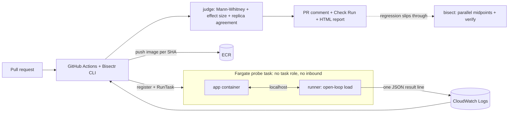

# Bisectr

A cost-and-performance gate for container services, with automatic bisect as the safety net.

Bisectr runs your pull request and your main branch side by side on AWS Fargate under identical load,
compares them statistically, and reports on the PR whether the change made the service slower, flakier
or more expensive to run. If a regression slips through, Bisectr binary-searches the commit range and
names the responsible commit.

> **Status:** hackathon build. Every number in the results table must come from `eval/results.csv`,
> produced by `bisectr eval` on real Fargate runs.

## How it works



* **Gate:** baseline (main) and candidate (PR) probes launch at the same moment, 3 replicas each.
  A candidate is *bad* only if the latency difference is statistically significant (Mann-Whitney),
  material (p95 ratio >= 1.25) and reproduced by at least 2 of 3 replicas. Inconclusive results are
  re-probed once with a longer run.
* **Cost:** measured CPU-seconds per request is converted to tasks needed at a target RPS (a sizing
  estimate, not a billing report). Pricing is reported only when both vCPU and memory rates are set.
* **Bisect:** k midpoints per round in parallel, `skip` for commits without an image, and a verify
  step that re-measures the culprit and its parent with 2x samples. It reports an ambiguous window
  rather than a confident wrong commit.
* **Security:** PR code is untrusted. Probe tasks have no task role and no inbound access; results
  travel through the runner's own log stream. CI uses GitHub OIDC, never static keys.
* **Persistence and reports:** configured runs use DynamoDB for TTL-bound baseline cache and run
  records, with private HTML reports in S3. Reports include a baseline/candidate latency percentile
  chart; local configurations write them under `runs/`.
* **Workload profiles:** name the scenario and mix weighted HTTP methods, paths, and JSON request
  bodies. GET-only endpoint configurations remain compatible. The runner sends requests at the
  configured open-loop rate.

## Quick start

```bash
python3.12 -m venv .venv && source .venv/bin/activate && pip install -e ".[dev]"
cd infra/envs/dev
terraform init -migrate-state \
  -backend-config="bucket=YOUR_TERRAFORM_STATE_BUCKET" \
  -backend-config="key=bisectr/dev/terraform.tfstate" \
  -backend-config="region=ap-south-1" \
  -backend-config="encrypt=true" \
  -backend-config="use_lockfile=true"
terraform apply \
  -var="github_repo=YOUR_OWNER/YOUR_REPO" \
  -var="gitlab_project_path=YOUR_GROUP/YOUR_PROJECT" \
  -var="gitlab_ref=main"
cd ../../..
git add -A && git commit -m init && ./scripts/push_images.sh
python scripts/gen_config.py            # then set pricing in bisectr.yaml
make gate-ok                            # control: expect PASS
make gate-bad                           # injected regression: expect FAIL
make history                            # real 10-commit history with one slow commit
```

Bisect demo:

```bash
cd ../bisectr-demo-history
bisectr bisect --config ../bisectr/bisectr.yaml --good <first_sha> --bad <last_sha>
```

Replace `first_sha` and `last_sha` with real commit SHAs from `git --no-pager log --oneline`;
do not type the placeholder names or the angle brackets literally.

## Commands

| Command | Purpose |
|---|---|
| `bisectr gate --candidate SHA [--baseline SHA\|auto]` | A/B probe, verdict, PR comment and Check Run with `--post --pr N`; writes an HTML report |
| `bisectr bisect --good SHA --bad SHA` | Find the first bad commit; opens an issue with `--post`; writes an HTML report |
| `bisectr eval --image SHA` | Evaluation harness, writes `eval/results.csv` |
| `bisectr validate --baseline IMAGE --candidate IMAGE [--trials N]` | Repeat a real image-to-image comparison without baseline caching; writes a CSV and stores each trial |
| `bisectr trends [--kind all\|gate\|bisect\|validate]` | Summarize recent local or DynamoDB run history |

Cloud setup provisions DynamoDB tables for baseline caching and run records, a private S3 bucket for
HTML reports, a monthly AWS Budget with SNS alerts, and the probe resources. `scripts/gen_config.py`
reads these Terraform outputs into `bisectr.yaml`. Set `alert_email` and `monthly_budget_usd` in
Terraform variables to subscribe to budget alerts. Runs are blocked at 90% of the configured budget.
For local development, leave the three cloud storage fields unset; baseline data, run records, and
HTML reports are written under `.bisectr_cache/` and `runs/`.

The Terraform state bucket is separate from the report bucket and must be created before `terraform
init`. Enable bucket versioning, encryption, and S3 Block Public Access. The backend uses S3 native
locking; see the migration notes in the [runbook](docs/runbook.md). Terraform
also adds a DynamoDB index used by `bisectr trends`; apply the state changes before using cloud trends.

## Evaluation

`eval/scenarios.yaml` injects regressions (`n_plus_one`, `slow_dependency`, `cpu_hot_loop`,
`error_rate`, `payload_bloat`) plus a noise-only control. Gate trials use one image with and without the
regression env var. Bisect trials use a synthetic history of 12 commits (the regression is injected from
a random commit onward). The real 10-commit history in `scripts/make_demo_history.sh` is used for the demo.

```bash
make eval        # prints the markdown table below
```

| Metric | Result |
|---|---|
| Gate: regressions detected (excluding control) | 15/15 |
| Gate: false positives on noise-only control | 0/3 |
| Gate: cost regressions detected (cpu_hot_loop, payload_bloat) | 6/6 |
| Bisect: exact culprit found | 4/5 |
| Bisect: wrong culprit reported | 0/5 |
| Bisect: ambiguous or flaky reported | 1/5 |
| Median wall time per gate run (s) | 94.1 |
| Median tasks per bisect | 30 |
| Median est. AWS cost per gate run (USD, from wall time) | 0.01 |

_Measured on AWS Fargate (ap-south-1): 3 gate trials per scenario (6 scenarios incl. one noise-only control), 1 bisect trial(s) per regression scenario on a synthetic 12-commit history, `on_cost_regression: fail` for this run. The cost figure is an upper bound (all tasks x full wall time) at US East list prices. Raw rows: `eval/results.csv`._

The metrics that matter most are the wrong-culprit and false-positive rates. An "ambiguous" answer is
safe. A confident wrong commit or a spurious failing check destroys trust.

For repeatable image-to-image experiments on a service you control, use `bisectr validate` with the
service's baseline and candidate images and a workload profile matching that service. The validation
protocol and reporting limits are in [docs/validation.md](docs/validation.md).
No third-party service has been tested as part of this upgrade.

## Guardrails

Kill switch (`aws ssm put-parameter --name /bisectr/enabled --value false --overwrite`), per-PR
concurrency group, `max_probes`, task timeouts, EventBridge + Lambda reaper (stops tasks older than 30
minutes, deregisters old task definition revisions), AWS Budgets alert, same-repository PRs only.

## GitHub Actions

Set the repository secret `BISECTR_ROLE_ARN` to the ARN of the CI role created by Terraform. On pushes
to `main`, `build-main` runs the test suite and publishes the runner and commit-tagged demo image to
ECR. `bisectr-gate` builds a PR candidate image without AWS credentials, then runs the gate from the
trusted base revision and posts the result. Because the gate uses AWS resources, it is limited to
non-draft pull requests from repository collaborators; fork pull requests do not run the cloud gate.

## GitLab CI

`.gitlab-ci.yml` runs tests for ordinary pipelines and runs the AWS-backed gate only on the protected
default branch. Configure Terraform with `gitlab_project_path` and `gitlab_ref`, then set the
`BISECTR_GITLAB_ROLE_ARN` GitLab CI/CD variable as protected (get the value with
`terraform output -raw gitlab_ci_role_arn`). The AWS trust policy is limited to that
project and branch; AWS credentials are not issued to merge-request pipelines. The gate compares a
protected-branch commit with its parent and requires a GitLab runner that supports Docker-in-Docker.

## Limitations

* Assumes the regression is reproducible under a synthetic scenario.
* Bisect assumes a roughly monotonic regression; reverted or intermittent ones report flaky or ambiguous.
* The runner shares CPU with the app, so absolute numbers are not production latency. Results are valid
  as relative comparisons under identical reservations.
* Cost output is a sizing model, not a billing report.
* Configured cloud runs cache baselines and store run records in DynamoDB with TTL; local development
  falls back to `.bisectr_cache/` and `runs/`.
* The evaluation uses a synthetic demo history. A third-party real-world validation run still needs
  a target service, real images, and measured repeat trials from the project owner.
* Terraform state is stored in the configured S3 backend, but dev and production still need separate
  state keys, review, and environment-specific variables before production use.
* `bisectr bisect --post` opens an issue for a verified culprit; it does not create a revert pull
  request.
* Scope: HTTP services in containers on Fargate; GitHub PR checks and protected-branch GitLab CI.

## Repository layout

`src/bisectr` (CLI and engine), `runner/` (sidecar image), `demo-app/` (service with injectable
regressions), `infra/envs/dev` (Terraform), `lambdas/reaper`, `action/` (GitHub Action), `eval/`,
`tests/`, `scripts/`, `docs/`.

## License

MIT


after terraform apply 

aws sts get-caller-identity
terraform -chdir=infra/envs/dev output

next 
cp bisectr.yaml /tmp/bisectr.yaml.before-generated-config.yaml
.venv/bin/python scripts/gen_config.py

next 
.venv/bin/python -m pip install -e ".[dev]"
.venv/bin/python -m pytest -q
./scripts/push_images.sh

next 
make gate-ok
make gate-bad

next 
./scripts/make_demo_history.sh 10 6
cd ../bisectr-demo-history

GOOD=$(awk 'NR==1 {print $2}' ../bisectr-shas.txt)
BAD=$(tail -n 1 ../bisectr-shas.txt | awk '{print $2}')

bisectr bisect --config ../bisectr/bisectr.yaml --good "$GOOD" --bad "$BAD"